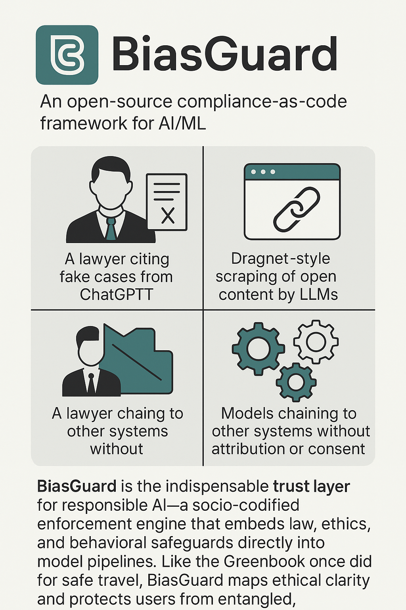
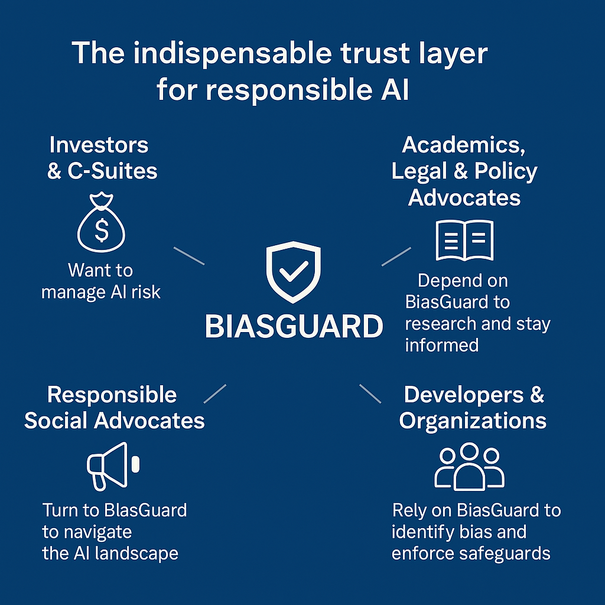
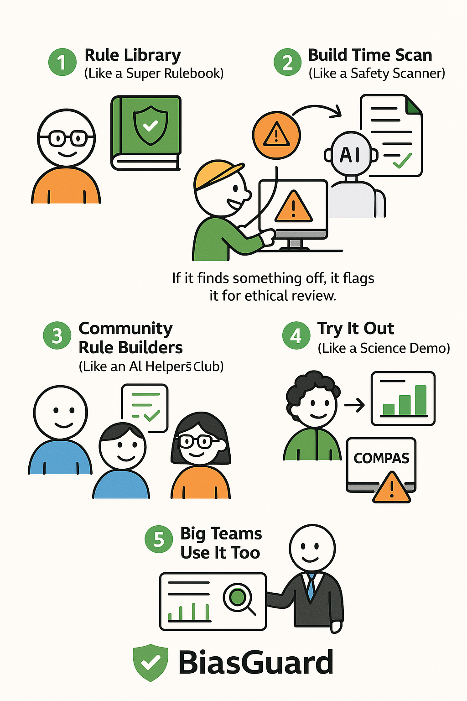
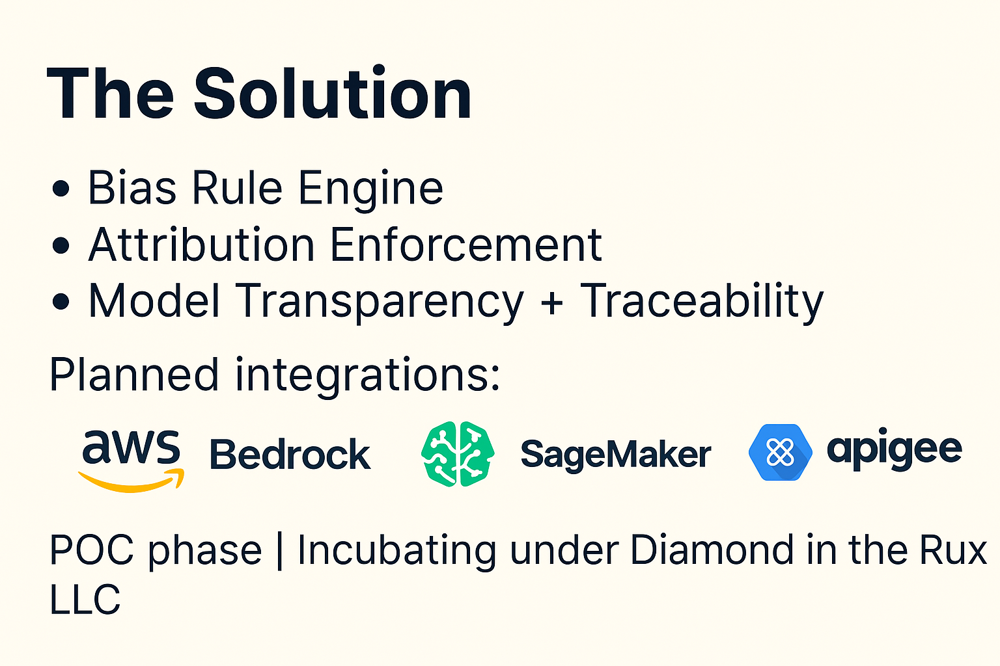
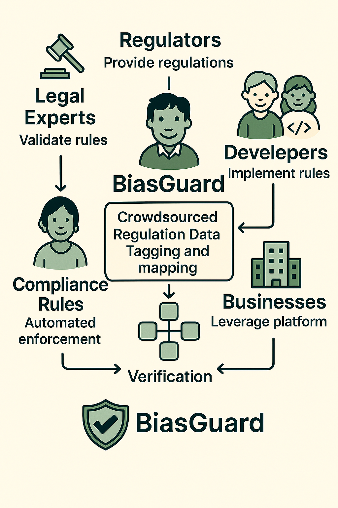
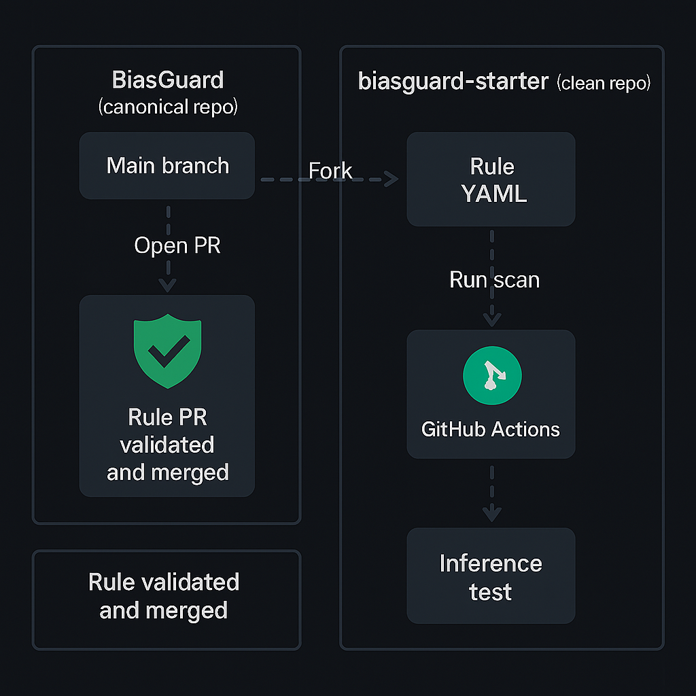
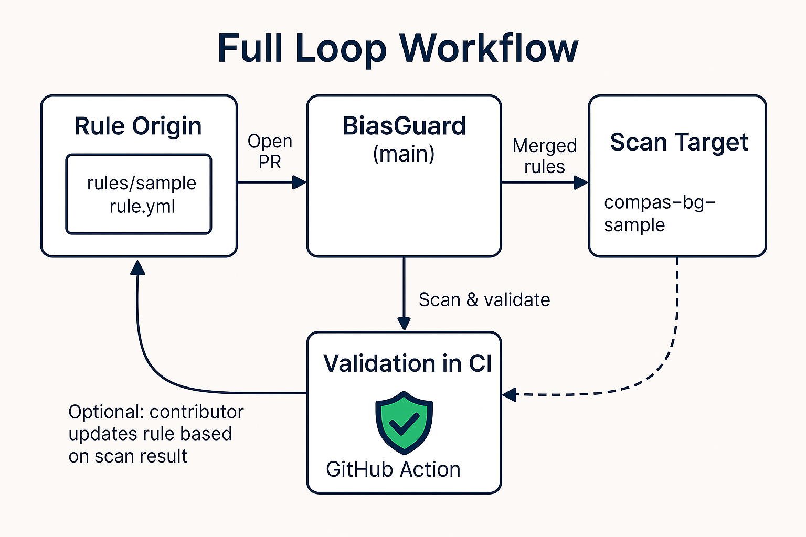
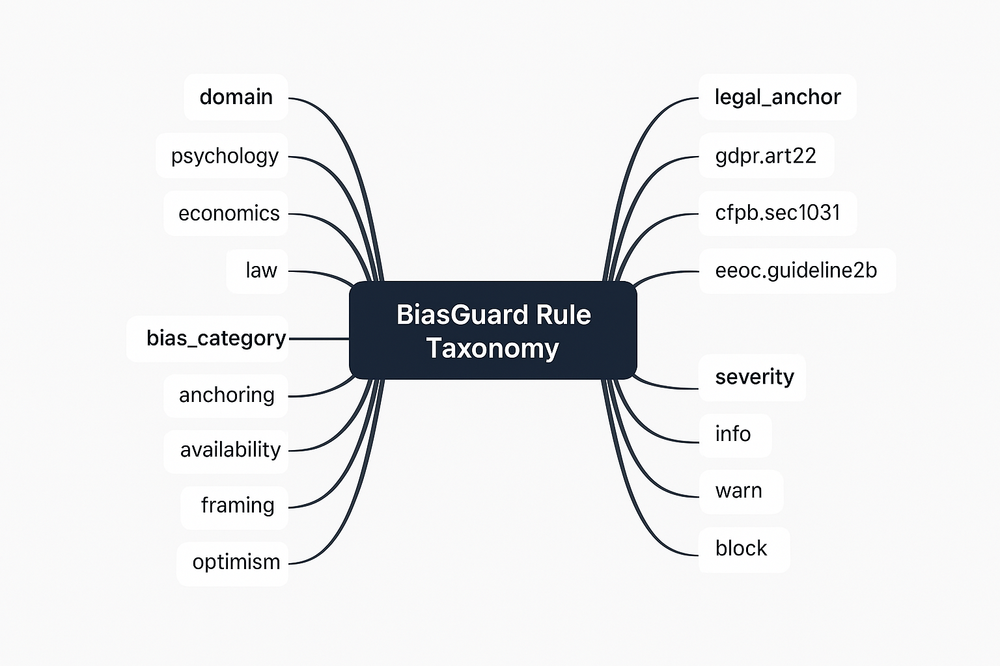

Thank You for Choosing to Deal with Bias—Within AI, Within Yourself, and Beyond!

You may have been routed here from [biasguard.host2go.net](http://biasguard.host2go.net). If so did you hesitate before clicking the link for `biasguard.host2go.net`? It’s okay if you did — I would too. You might have questioned the name, wondering whether the domain was legitimate or safe. Maybe even whether BiasGuard could really live up to its promise of addressing bias. That hesitation? It’s bias — the very thing we’re here to confront.

You may notice that the domain in your browser bar now shows `biasguard.biascompliance.ai`.  
That’s intentional. Both domains — `biasguard.host2go.net` and `biasguard.biascompliance.ai` — serve the exact same site, from the same trusted host.  

The difference you see is only in appearance — a real-world reflection of how subtle bias can influence trust before substance is even evaluated.

You see, bias is something we all carry — often without realizing it. It’s subconscious and instantaneous, triggered by our experiences, societal influences, and yes, even how we engage with technology. When you paused to think, you engaged with the bias reflex. This is true for AI as well: algorithms and models can perpetuate the biases they’re trained on, leading to flawed outcomes and inaccuracies.

But here’s the thing — now you’ve taken the first step toward confronting that bias.  
BiasGuard is designed to help you identify and address bias in AI, so you can build systems that are not only effective, but also ethical, accountable, and fair.

This isn’t just about cleaning up algorithms; it’s about taking responsibility — both within AI and within ourselves.

---

# 🛡️ BiasGuard: The Indispensable Trust Layer for Responsible AI

**BiasGuard** is an AI policy enforcement framework built to make AI systems accountable, auditable, and aligned with ethical and legal standards from the start. By integrating directly into AI/ML pipelines, BiasGuard provides codified bias prevention, transparency, and compliance through an open-core rule engine.

> Inspired by tools like CloudFormation Guard and OPA  
> Powered by rule-based enforcement and CI/CD integration  
> Designed for developers, researchers, auditors, legal advocates, and social impact professionals

---

## 🚀 COMPAS MVP Quickstart

The COMPAS Minimum Viable Product demonstrates BiasGuard's rule-driven
scanning on a small sample of the ProPublica COMPAS dataset. To run the
baseline scan locally:

```bash
python bgcore_runner.py --rules rules/compas_base.yaml --data datasets/compas.csv
```

This placeholder command validates the repository wiring and will be
expanded in later tickets to produce detailed reports and CI enforcement.

GitHub Actions workflows in `.github/workflows/` will invoke the same
runner to keep results reproducible.

---

## ⚠️ Why We Need BiasGuard

AI systems are becoming more powerful — and more unpredictable.

- 🧑‍⚖️ A lawyer citing fake cases from ChatGPT  
- 🌐 Dragnet-style scraping of public content by LLMs  
- 🤖 Models chaining to external systems, without attribution or oversight


**BiasGuard is our answer.**  
A socio-codified trust layer that embeds behavioral safeguards, legal clauses, and ethical governance directly into model pipelines — before harm occurs.



---

## 🤖 What Is BiasGuard?



**Explain Like I'm 6:**  
BiasGuard is like a superhero for AI — it helps catch and prevent bias before it causes problems!

---

## 🔌 How It Integrates

BiasGuard integrates directly into CI/CD pipelines and supports API-driven connections to platforms like AWS Bedrock, SageMaker, and Apigee.



Policy enforcement becomes automated and continuous — helping teams build safer systems with real-time rule validation.

---

## 🌍 Who Relies on BiasGuard?

BiasGuard serves the broader ecosystem of responsible AI builders and defenders:

| Stakeholder Group | How BG Helps |
|-------------------|--------------|
| 🔧 **Developers** | Codify fairness, validate AI behavior, block unsafe outputs |
| 📊 **Executives & Investors** | Identify risk exposure, reduce liability, validate ethics claims |
| ⚖️ **Academics, Legal & Policy Advocates** | Translate evolving laws into enforceable code |
| 🌱 **Social & DEIA Advocates** | Protect communities at risk from unaccountable models |
| 🧠 **Researchers & Audit Partners** | Experiment with transparent, clause-aware model governance |



---

## 🔄 CI/CD Workflow

The BiasGuard contributor flow and enforcement lifecycle is streamlined using GitHub Actions and validation automation.

### ✅ Contributor Loop

- **Rule Submission** — New YAML rules submitted via Pull Requests  
- **Validation** — Automated checks confirm structure, tags, and references  
- **Enforcement** — Approved rules deploy and run in CI/CD pipelines  





---

## 📚 Rule Taxonomy

Rules are organized by domain (e.g., housing, hiring, education) and mapped to relevant clauses or behavioral risks.



This structure ensures that rules are traceable, scalable, and enforceable across model types and use cases.

---

## 🙌 Get Involved

- 📬 Contact: [m.ruxsaksriskul@gmail.com](mailto:m.ruxsaksriskul@gmail.com)  
- 🌐 Visit: [biasguard.host2go.net](http://biasguard.host2go.net)  
- 💡 Star / Fork / Watch: [GitHub Repo](https://github.com/mruxsaksriskul/biasguard)  
- 🤝 Contribute: Submit a rule, share a use case, or help us map legal frameworks to policy.

---

*This README is part of BiasGuard's open-source initiative and serves as a comprehensive guide to our mission, workflows, and integration points.*

© 2025 Diamond in the Rux LLC – All Rights Reserved  
BiasGuard™ is a project built for public impact, incubated under a responsible open-core model.
